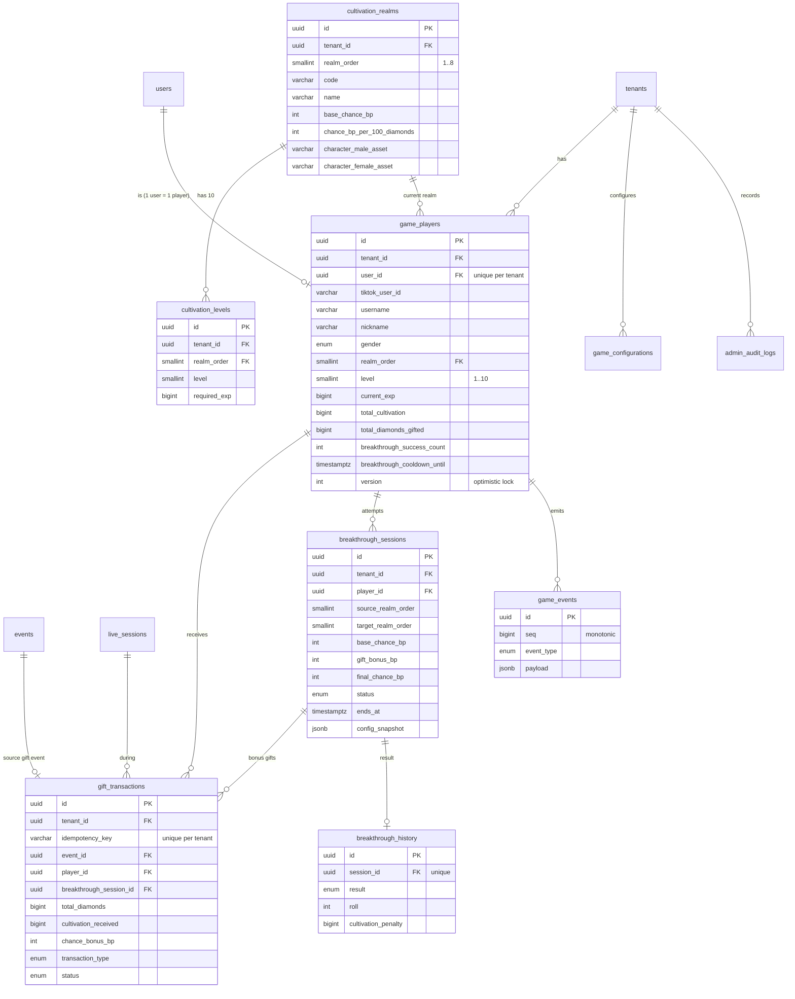

# 03 — ERD: TU TIÊN LIVE

> Phiên bản 1.0 · 2026-11-05 · Chủ sở hữu: Agent 1 (Architect) · Người triển khai: Agent 2 (Backend)
> Bổ sung vào `prisma/schema.prisma` hiện có. **Không sửa** cấu trúc các bảng lõi (`tenants`, `users`, `events`, `live_sessions`) ngoài hai thay đổi cộng thêm ở §5.

## 1. Nguyên tắc

1. Mọi bảng mới có `tenant_id` và `@@unique([tenantId, id])`; quan hệ giữa các bảng dùng **FK tổ hợp** `[tenant_id, x_id] → [tenant_id, id]` như bảng `events` đang làm. PostgreSQL chặn tham chiếu chéo tenant.
2. Tiền tệ game (tu vi, kim cương) dùng `BIGINT`. Tỷ lệ dùng **basis points** `INT` (9500 = 95,00%).
3. Nhân vật gắn với `users` (định danh 3 mức đã có), không gắn với `live_sessions` — tiến trình sống qua nhiều buổi LIVE.
4. Mọi thay đổi `current_exp` đều có một dòng `gift_transactions` hoặc `admin_audit_logs` giải thích nó (NFR-06).
5. Idempotency nằm ở **ràng buộc unique của DB**, không ở cache trong bộ nhớ (cache dedup hiện có của `EventIngestionService` mất khi restart).

## 2. Sơ đồ



## 3. Đặc tả bảng

### 3.1 `game_players` (spec: Players)

| Cột | Kiểu | Ràng buộc | Ghi chú |
|---|---|---|---|
| `id` | uuid | PK | |
| `tenant_id` | uuid | NOT NULL, FK tenants | |
| `user_id` | uuid | NOT NULL, FK `(tenant_id,user_id) → users` | Unique `(tenant_id, user_id)` |
| `tiktok_user_id` | varchar(120) | NULL | Bản sao `users.platform_user_id` lúc tạo, phục vụ tìm kiếm |
| `username` | varchar(255) | NOT NULL | `users.unique_id`; cập nhật khi người xem đổi handle |
| `nickname` | varchar(255) | NULL | |
| `avatar_url` | text | NULL | |
| `gender` | enum `player_gender` (`male`,`female`) | NOT NULL | |
| `realm_order` | smallint | NOT NULL, CHECK 1–8, FK `(tenant_id, realm_order) → cultivation_realms` | Spec gọi là `realm_id`; dùng thứ tự để sắp xếp không cần JOIN |
| `level` | smallint | NOT NULL DEFAULT 1, CHECK 1–10 | |
| `current_exp` | bigint | NOT NULL DEFAULT 0, CHECK ≥ 0 | |
| `total_cultivation` | bigint | NOT NULL DEFAULT 0 | Không bao giờ giảm |
| `total_diamonds_gifted` | bigint | NOT NULL DEFAULT 0 | Cho "Top quà tặng" |
| `breakthrough_success_count` | int | NOT NULL DEFAULT 0 | |
| `breakthrough_fail_count` | int | NOT NULL DEFAULT 0 | |
| `breakthrough_cooldown_until` | timestamptz | NULL | |
| `realm_reached_at` | timestamptz | NOT NULL | Khóa phụ bảng xếp hạng (đổi khi realm/level đổi) |
| `cultivation_reached_at` | timestamptz | NOT NULL | Đổi khi `total_cultivation` đổi |
| `gifts_reached_at` | timestamptz | NOT NULL | Đổi khi `total_diamonds_gifted` đổi |
| `gender_changed_at` | timestamptz | NULL | Cooldown 24h |
| `status` | enum `player_status` (`active`,`banned`) | DEFAULT `active` | |
| `version` | int | NOT NULL DEFAULT 0 | Tăng mỗi lần ghi; Admin PATCH dùng để chống ghi đè |
| `joined_at`, `last_active_at`, `created_at`, `updated_at` | timestamptz | | |

Index:
- `UNIQUE (tenant_id, user_id)`
- `(tenant_id, realm_order DESC, level DESC, current_exp DESC, realm_reached_at ASC)` — Top cảnh giới
- `(tenant_id, total_cultivation DESC, cultivation_reached_at ASC)` — Top tu vi
- `(tenant_id, breakthrough_success_count DESC)`, `(tenant_id, total_diamonds_gifted DESC, gifts_reached_at ASC)`
- `(tenant_id, lower(username))` + trigram GIN trên `username`, `nickname` cho tìm kiếm Admin

### 3.2 `cultivation_realms`

| Cột | Kiểu | Ràng buộc |
|---|---|---|
| `id` | uuid | PK |
| `tenant_id` | uuid | FK |
| `realm_order` | smallint | CHECK 1–8; `UNIQUE (tenant_id, realm_order)` |
| `code` | varchar(40) | `luyen_khi` … `dai_thua`; `UNIQUE (tenant_id, code)` |
| `name` | varchar(80) | "Luyện Khí" |
| `base_chance_bp` | int | NULL cho Đại Thừa; CHECK 0–10000 |
| `chance_bp_per_100_diamonds` | int | NULL cho Đại Thừa |
| `theme_color` | char(7) | `#7FD3FF` |
| `character_male_asset`, `character_female_asset` | varchar(120) | Tên file, phải khớp regex whitelist asset (Asset Guidelines §4) |

Seed tự động 8 dòng khi tenant bật game lần đầu.

### 3.3 `cultivation_levels`

`id`, `tenant_id`, `realm_order` (FK tổ hợp tới realms), `level` (CHECK 1–10), `required_exp` bigint CHECK > 0. `UNIQUE (tenant_id, realm_order, level)`. Seed 80 dòng theo GDD §4.2.

Engine đọc cả 80 dòng vào cache theo tenant (bust khi Admin sửa).

### 3.4 `gift_transactions` (spec: GiftTransactions)

| Cột | Kiểu | Ghi chú |
|---|---|---|
| `id` | uuid PK | |
| `tenant_id` | uuid | |
| `idempotency_key` | varchar(160) | **`UNIQUE (tenant_id, idempotency_key)`** — xem Architecture §5 |
| `event_id` | uuid NULL | FK `(tenant_id, event_id) → events`; spec gọi là `event_id` |
| `live_session_id` | uuid | FK tổ hợp `live_sessions` |
| `player_id` | uuid NULL | NULL khi `unjoined_pending` |
| `user_id` | uuid | FK tổ hợp `users`; để gắn quà chờ khi người đó tham gia |
| `breakthrough_session_id` | uuid NULL | Có khi quà dùng tăng tỷ lệ |
| `gift_id`, `gift_name` | varchar | Từ payload chuẩn hóa |
| `diamond_value` | int NULL | `data.diamondCount` |
| `gift_quantity` | int | `data.repeatCount` |
| `total_diamonds` | bigint | |
| `cultivation_received` | bigint DEFAULT 0 | |
| `chance_bonus_bp` | int DEFAULT 0 | |
| `transaction_type` | enum `gift_tx_type` | `cultivation`, `breakthrough_bonus`, `cultivation_and_bonus`, `unjoined_pending`, `unpriced`, `ignored_game_disabled`, `overflow_capped`, `admin_adjustment` |
| `status` | enum `gift_tx_status` | `applied`, `pending`, `failed`, `expired` |
| `realm_before`, `level_before`, `exp_before`, `realm_after`, `level_after`, `exp_after` | smallint/bigint NULL | Ảnh chụp trước/sau để truy vết |
| `error_message` | text NULL | |
| `occurred_at` | timestamptz | Thời điểm TikTok |
| `created_at` | timestamptz | |

Index: `(tenant_id, player_id, created_at DESC)`, `(tenant_id, status) WHERE status <> 'applied'` (danh sách lỗi Admin), `(tenant_id, user_id) WHERE status = 'pending'`, `(tenant_id, live_session_id, total_diamonds DESC)`.

### 3.5 `breakthrough_sessions`

| Cột | Kiểu | Ghi chú |
|---|---|---|
| `id` | uuid PK | |
| `tenant_id`, `player_id`, `live_session_id` | uuid | FK tổ hợp |
| `source_realm_order`, `target_realm_order` | smallint | CHECK `target = source + 1` |
| `base_chance_bp`, `max_chance_bp` | int | Chụp từ cấu hình |
| `bonus_diamonds` | bigint DEFAULT 0 | |
| `gift_bonus_bp` | int DEFAULT 0 | |
| `final_chance_bp` | int NULL | Ghi khi resolve |
| `status` | enum `breakthrough_status` | `preparing`, `resolving`, `succeeded`, `failed`, `cancelled` |
| `config_snapshot` | jsonb | penalty, cooldown, addExp…, lúc bắt đầu |
| `trigger` | enum (`chat`, `api`) | Nguồn bắt đầu |
| `request_key`, `request_hash` | varchar(160) NULL, char(64) NULL | Idempotency-Key của REST; `UNIQUE (tenant_id, request_key)` |
| `started_at`, `ends_at`, `ended_at` | timestamptz | |

Ràng buộc then chốt (migration SQL thủ công, Prisma không biểu diễn được):

```sql
CREATE UNIQUE INDEX breakthrough_one_active_per_player
  ON breakthrough_sessions (tenant_id, player_id)
  WHERE status IN ('preparing', 'resolving');

CREATE INDEX breakthrough_due ON breakthrough_sessions (ends_at)
  WHERE status = 'preparing';   -- dùng cho recovery sau restart
```

### 3.6 `breakthrough_history`

Bản ghi bất biến của kết quả: `id`, `tenant_id`, `player_id`, `session_id` (**UNIQUE** — đảm bảo resolve một lần), `result` (`success`/`failure`), `roll` int (0–9999), `final_chance_bp`, `cultivation_penalty` bigint, `exp_before`, `exp_after`, `realm_before`, `realm_after`, `created_at`.

### 3.7 `game_configurations`

| Cột | Kiểu | Ghi chú |
|---|---|---|
| `tenant_id` | uuid | PK phần 1 |
| `config_key` | varchar(80) | PK phần 2; khóa trong GDD §10 |
| `config_value` | jsonb | Validate bằng schema theo khóa |
| `revision` | int | Revision toàn tenant tại lần ghi cuối |
| `updated_by_api_key_id` | uuid NULL | |
| `updated_at` | timestamptz | |

Revision toàn tenant = `max(revision)`. `PUT /config` khóa dòng `tenant_settings` của tenant (`SELECT … FOR UPDATE`) để tuần tự hóa các lần ghi và so sánh `baseRevision`.

### 3.8 `game_events` (spec: GameEvents)

Log miền game + outbox cho realtime: `id` uuid, `seq` **bigserial** (tăng đơn điệu, overlay dùng để phát hiện mất frame), `tenant_id`, `live_session_id` NULL, `player_id` NULL, `event_type` enum (`player_joined`, `player_returned`, `exp_gained`, `level_up`, `max_level_reached`, `breakthrough_started`, `breakthrough_bonus`, `breakthrough_succeeded`, `breakthrough_failed`, `breakthrough_cancelled`, `player_adjusted`, `player_reset`, `config_changed`, `command_rejected`), `payload` jsonb, `created_at`.
Index: `(tenant_id, seq)`, `(tenant_id, player_id, created_at DESC)`. Retention theo `tenant_settings.event_retention_days`.

### 3.9 `admin_audit_logs`

`id`, `tenant_id`, `actor_api_key_id`, `action` (`player.adjust`, `player.reset`, `config.update`, `gift_tx.retry`), `target_type`, `target_id`, `before` jsonb, `after` jsonb, `reason` text NOT NULL, `request_id`, `created_at`. Chỉ INSERT; không có API sửa/xóa.

## 4. Giao dịch & khóa

Xử lý một gift (trong `prisma.$transaction`, isolation READ COMMITTED):

```sql
-- 1. Chiếm khóa idempotency trước (unique constraint chọn người thắng)
INSERT INTO gift_transactions (..., idempotency_key, status) VALUES (..., $key, 'pending');
--    → P2002 / 23505: đã xử lý → trả kết quả cũ, dừng.
-- 2. Khóa dòng người chơi
SELECT * FROM game_players WHERE tenant_id=$t AND id=$p FOR UPDATE;
-- 3. Kiểm tra phiên độ kiếp đang mở của người này
SELECT * FROM breakthrough_sessions WHERE tenant_id=$t AND player_id=$p AND status='preparing' FOR UPDATE;
-- 4. Tính toán trong code (engine thuần), cập nhật player / session
-- 5. UPDATE gift_transactions SET status='applied', ... ; INSERT game_events ...
COMMIT;
```

Thứ tự khóa cố định **player → breakthrough_session** ở mọi luồng (gift, resolve, admin) để tránh deadlock. Vẫn bọc retry jitter cho `40P01` giống `user.repository.ts`.

## 5. Thay đổi cộng thêm vào bảng có sẵn

| Bảng | Thay đổi | Lý do |
|---|---|---|
| `events` | `@@unique([tenantId, id])` | Cho phép FK tổ hợp từ `gift_transactions`. Không đổi dữ liệu. |
| `api_keys` | `scopes text[] NOT NULL DEFAULT '{*}'` | Phân quyền `game:overlay` / `game:admin`; key cũ giữ quyền đầy đủ → không phá vỡ client hiện có |

## 6. Prisma (trích)

```prisma
enum PlayerGender { male female }
enum BreakthroughStatus { preparing resolving succeeded failed cancelled }
enum GiftTxStatus { applied pending failed expired }

model GamePlayer {
  id                       String       @id @default(uuid()) @db.Uuid
  tenantId                 String       @map("tenant_id") @db.Uuid
  userId                   String       @map("user_id") @db.Uuid
  username                 String       @db.VarChar(255)
  nickname                 String?      @db.VarChar(255)
  gender                   PlayerGender @default(male)
  realmOrder               Int          @default(1) @map("realm_order") @db.SmallInt
  level                    Int          @default(1) @db.SmallInt
  currentExp               BigInt       @default(0) @map("current_exp")
  totalCultivation         BigInt       @default(0) @map("total_cultivation")
  totalDiamondsGifted      BigInt       @default(0) @map("total_diamonds_gifted")
  breakthroughSuccessCount Int          @default(0) @map("breakthrough_success_count")
  breakthroughCooldownUntil DateTime?   @map("breakthrough_cooldown_until") @db.Timestamptz(6)
  version                  Int          @default(0)
  // ... các cột *_reached_at, timestamps

  tenant Tenant           @relation(fields: [tenantId], references: [id], onDelete: Cascade)
  user   User             @relation(fields: [tenantId, userId], references: [tenantId, id], onDelete: Cascade)
  realm  CultivationRealm @relation(fields: [tenantId, realmOrder], references: [tenantId, realmOrder])

  @@unique([tenantId, id])
  @@unique([tenantId, userId])
  @@index([tenantId, realmOrder(sort: Desc), level(sort: Desc), currentExp(sort: Desc)])
  @@index([tenantId, totalCultivation(sort: Desc)])
  @@map("game_players")
}

model GiftTransaction {
  id                    String       @id @default(uuid()) @db.Uuid
  tenantId              String       @map("tenant_id") @db.Uuid
  idempotencyKey        String       @map("idempotency_key") @db.VarChar(160)
  eventId               String?      @map("event_id") @db.Uuid
  playerId              String?      @map("player_id") @db.Uuid
  breakthroughSessionId String?      @map("breakthrough_session_id") @db.Uuid
  totalDiamonds         BigInt       @default(0) @map("total_diamonds")
  cultivationReceived   BigInt       @default(0) @map("cultivation_received")
  chanceBonusBp         Int          @default(0) @map("chance_bonus_bp")
  status                GiftTxStatus @default(pending)
  // ...

  @@unique([tenantId, idempotencyKey])
  @@index([tenantId, playerId, createdAt(sort: Desc)])
  @@map("gift_transactions")
}
```

Migration đặt tên `2026xxxx_tu_tien_live_core`; partial index và CHECK constraint viết tay trong file `migration.sql`.

## 7. Ánh xạ tên với spec

| Spec | ERD này | Lý do đổi |
|---|---|---|
| `Players` | `game_players` | Tránh nhầm với `users` lõi |
| `Players.realm_id` | `realm_order` | Sắp xếp/bảng xếp hạng không cần JOIN; vẫn là FK |
| `GiftTransactions.event_id` | `event_id` + `idempotency_key` | `event_id` là FK tới `events`; khóa idempotency là chuỗi riêng vì `events` không unique theo nguồn |
| `BreakthroughSessions.ended_at` | `ends_at` + `ended_at` | Cần cả hạn chót (để recovery) và thời điểm thật |
| `GameConfigurations.id` | PK `(tenant_id, config_key)` | Đa tenant |

## 8. Changelog (A1 Audit)

- **2026-11-05 (A1 Architect)**:
  - Xác nhận bắt buộc thêm `@@unique([tenantId, id])` vào model `Event` để hỗ trợ FK tổ hợp `[tenantId, eventId] -> [tenantId, id]` từ `gift_transactions`.
  - Xác nhận bắt buộc thêm `@@unique([tenantId, realmOrder])` vào model `CultivationRealm` để `game_players` và `cultivation_levels` tham chiếu qua `[tenantId, realmOrder]`.
  - Xác nhận bổ sung `scopes String[] @default(["*"]) @map("scopes")` vào model `ApiKey`.
  - Ghi nhận `breakthrough_one_active_per_player` là partial unique index (`WHERE status IN ('preparing', 'resolving')`), cần sinh migration thô (`prisma migrate dev --create-only`) rồi chèn SQL tay trước khi áp dụng.