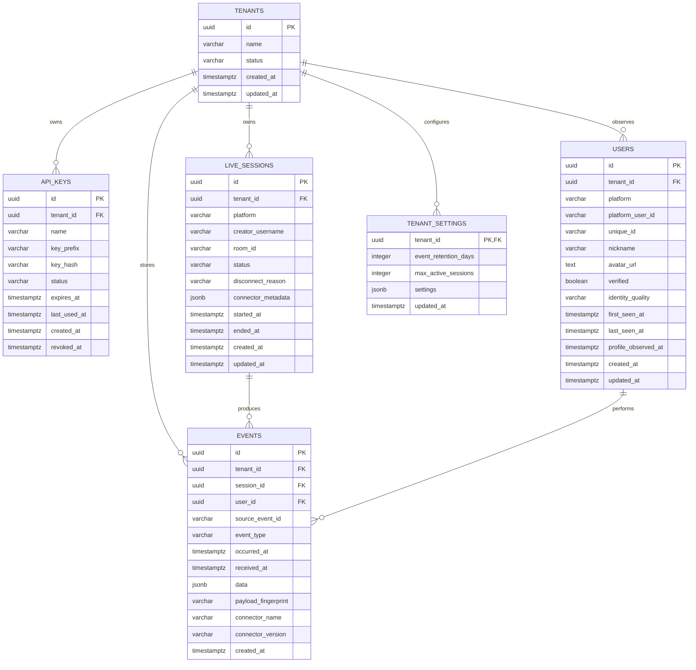

# TikUser API — Entity Relationship Design (ERD)

- **Version:** 1.1.0
- **Database:** PostgreSQL 15+
- **Design:** Multi-tenant, session-oriented event ingestion
- **Status:** MVP logical and physical baseline

## 1. Design principles

1. Every customer-owned entity is tenant scoped.
2. Platform user identity is not the same as mutable TikTok username or nickname.
3. Events are append-oriented records; profile rows are mutable snapshots.
4. Session lifecycle and event ingestion are separate concerns.
5. Raw connector payloads are optional and disabled by default.
6. Use UTC timestamps (`timestamptz`) throughout.
7. Use UUID primary keys.
8. Enforce tenant ownership in service/repository queries; consider PostgreSQL Row Level Security as defense in depth.

## 2. ER diagram



## 3. Entities and constraints

### 3.1 tenants
Represents a customer/workspace.
- `id`: UUID primary key.
- `name`: required display name.
- `status`: `active`, `suspended`, `deleted`.
- Unique tenant identity is independent of user accounts in the future.

### 3.2 api_keys
One tenant can own many API keys.
- Store only a hash of a cryptographically random secret.
- `key_prefix` is a short non-secret identifier for dashboard display.
- `status`: `active`, `revoked`, `expired`.
- Never return the secret after the one-time creation response.
- Index `(tenant_id, status)` and unique `key_prefix` if globally unique.

### 3.3 live_sessions
One tenant can own many sessions.
- `platform`: initially `tiktok`.
- `creator_username`: normalized handle without leading `@`; preserve display form separately only if needed.
- `room_id`: nullable until connector provides it.
- `status`: `queued`, `connecting`, `connected`, `reconnecting`, `disconnected`, `ended`, `failed`.
- `disconnect_reason`: nullable diagnostic code/message, sanitized.
- `connector_metadata`: allowlisted metadata only; do not store credentials.
- Partial unique index should prevent duplicate active session for `(tenant_id, platform, lower(creator_username))` for statuses `queued`, `connecting`, `connected`, `reconnecting`.

### 3.4 users
Stores users observed through events, not an arbitrary global TikTok directory.
- `platform_user_id`: preferred stable platform identifier; nullable if unavailable.
- `unique_id`: mutable handle; nullable.
- `nickname`: nullable and not unique.
- `avatar_url`: nullable.
- `identity_quality`: `platform_id`, `handle_fallback`, `event_only`.
- `first_seen_at`, `last_seen_at`: observation timestamps.
- `profile_observed_at`: when the current profile snapshot was observed.
- Recommended uniqueness:
  - Unique `(tenant_id, platform, platform_user_id)` where platform_user_id is not null.
  - If platform_user_id is absent, use a deterministic fallback key stored separately or a carefully defined unique `(tenant_id, platform, unique_id)` partial index. Do not merge solely by nickname.
- Tenant scoping means the same platform user may have separate observation records in separate tenants. This simplifies isolation and deletion.

### 3.5 events
Append-oriented event history.
- `event_type`: `member`, `chat`, `gift`, `like`, `follow`, `share`, `roomUser`, `connected`, `disconnected`, `error`.
- `data`: validated type-specific JSONB.
- `source_event_id`: nullable source identifier.
- `payload_fingerprint`: optional short-lived deduplication aid.
- `occurred_at`: source timestamp if available; otherwise equal to received time.
- `received_at`: always assigned by service.
- Foreign key `(tenant_id, session_id)` and `(tenant_id, user_id)` should be enforced with composite keys or service-level tenant checks. Prefer composite constraints to prevent cross-tenant references.

### 3.6 tenant_settings
One-to-one tenant configuration.
- `event_retention_days`: proposed default 30.
- `max_active_sessions`: plan/configuration limit.
- `settings`: allowlisted JSON settings only; validate with schema.

## 4. PostgreSQL DDL baseline

The following is a starting migration. AI must convert it into versioned migrations, add composite tenant-safe foreign keys, and verify indexes against actual queries.

```sql
CREATE EXTENSION IF NOT EXISTS pgcrypto;

CREATE TABLE tenants (
  id UUID PRIMARY KEY DEFAULT gen_random_uuid(),
  name VARCHAR(160) NOT NULL,
  status VARCHAR(20) NOT NULL DEFAULT 'active'
    CHECK (status IN ('active','suspended','deleted')),
  created_at TIMESTAMPTZ NOT NULL DEFAULT now(),
  updated_at TIMESTAMPTZ NOT NULL DEFAULT now()
);

CREATE TABLE api_keys (
  id UUID PRIMARY KEY DEFAULT gen_random_uuid(),
  tenant_id UUID NOT NULL REFERENCES tenants(id) ON DELETE CASCADE,
  name VARCHAR(120) NOT NULL,
  key_prefix VARCHAR(24) NOT NULL UNIQUE,
  key_hash TEXT NOT NULL,
  status VARCHAR(20) NOT NULL DEFAULT 'active'
    CHECK (status IN ('active','revoked','expired')),
  expires_at TIMESTAMPTZ,
  last_used_at TIMESTAMPTZ,
  created_at TIMESTAMPTZ NOT NULL DEFAULT now(),
  revoked_at TIMESTAMPTZ
);
CREATE INDEX idx_api_keys_tenant_status ON api_keys(tenant_id, status);

CREATE TABLE live_sessions (
  id UUID PRIMARY KEY DEFAULT gen_random_uuid(),
  tenant_id UUID NOT NULL REFERENCES tenants(id) ON DELETE CASCADE,
  platform VARCHAR(30) NOT NULL DEFAULT 'tiktok',
  creator_username VARCHAR(255) NOT NULL,
  room_id VARCHAR(255),
  status VARCHAR(24) NOT NULL DEFAULT 'queued'
    CHECK (status IN ('queued','connecting','connected','reconnecting',
                      'disconnected','ended','failed')),
  disconnect_reason TEXT,
  connector_metadata JSONB NOT NULL DEFAULT '{}'::jsonb,
  started_at TIMESTAMPTZ,
  ended_at TIMESTAMPTZ,
  created_at TIMESTAMPTZ NOT NULL DEFAULT now(),
  updated_at TIMESTAMPTZ NOT NULL DEFAULT now()
);
CREATE INDEX idx_sessions_tenant_created ON live_sessions(tenant_id, created_at DESC);
CREATE INDEX idx_sessions_tenant_status ON live_sessions(tenant_id, status);
CREATE UNIQUE INDEX uq_active_session_creator
  ON live_sessions(tenant_id, platform, lower(creator_username))
  WHERE status IN ('queued','connecting','connected','reconnecting');

CREATE TABLE users (
  id UUID PRIMARY KEY DEFAULT gen_random_uuid(),
  tenant_id UUID NOT NULL REFERENCES tenants(id) ON DELETE CASCADE,
  platform VARCHAR(30) NOT NULL DEFAULT 'tiktok',
  platform_user_id VARCHAR(120),
  unique_id VARCHAR(255),
  nickname VARCHAR(255),
  avatar_url TEXT,
  verified BOOLEAN,
  identity_quality VARCHAR(24) NOT NULL DEFAULT 'event_only'
    CHECK (identity_quality IN ('platform_id','handle_fallback','event_only')),
  first_seen_at TIMESTAMPTZ NOT NULL DEFAULT now(),
  last_seen_at TIMESTAMPTZ NOT NULL DEFAULT now(),
  profile_observed_at TIMESTAMPTZ,
  created_at TIMESTAMPTZ NOT NULL DEFAULT now(),
  updated_at TIMESTAMPTZ NOT NULL DEFAULT now()
);
CREATE UNIQUE INDEX uq_users_platform_id
  ON users(tenant_id, platform, platform_user_id)
  WHERE platform_user_id IS NOT NULL;
CREATE INDEX idx_users_tenant_unique_id
  ON users(tenant_id, platform, lower(unique_id))
  WHERE unique_id IS NOT NULL;
CREATE INDEX idx_users_tenant_last_seen
  ON users(tenant_id, last_seen_at DESC);

CREATE TABLE events (
  id UUID PRIMARY KEY DEFAULT gen_random_uuid(),
  tenant_id UUID NOT NULL REFERENCES tenants(id) ON DELETE CASCADE,
  session_id UUID NOT NULL REFERENCES live_sessions(id) ON DELETE CASCADE,
  user_id UUID,
  source_event_id VARCHAR(255),
  event_type VARCHAR(40) NOT NULL
    CHECK (event_type IN ('member','chat','gift','like','follow','share',
                          'roomUser','connected','disconnected','error')),
  occurred_at TIMESTAMPTZ NOT NULL,
  received_at TIMESTAMPTZ NOT NULL DEFAULT now(),
  data JSONB NOT NULL DEFAULT '{}'::jsonb,
  payload_fingerprint VARCHAR(128),
  connector_name VARCHAR(120),
  connector_version VARCHAR(80),
  created_at TIMESTAMPTZ NOT NULL DEFAULT now(),
  CONSTRAINT fk_events_user_tenant
    FOREIGN KEY (user_id) REFERENCES users(id) ON DELETE SET NULL
);
CREATE INDEX idx_events_tenant_session_received
  ON events(tenant_id, session_id, received_at DESC);
CREATE INDEX idx_events_tenant_type_received
  ON events(tenant_id, event_type, received_at DESC);
CREATE INDEX idx_events_user_received
  ON events(user_id, received_at DESC);
CREATE INDEX idx_events_data_gin ON events USING GIN(data);

CREATE TABLE tenant_settings (
  tenant_id UUID PRIMARY KEY REFERENCES tenants(id) ON DELETE CASCADE,
  event_retention_days INTEGER NOT NULL DEFAULT 30
    CHECK (event_retention_days BETWEEN 1 AND 3650),
  max_active_sessions INTEGER NOT NULL DEFAULT 1
    CHECK (max_active_sessions >= 1),
  settings JSONB NOT NULL DEFAULT '{}'::jsonb,
  updated_at TIMESTAMPTZ NOT NULL DEFAULT now()
);
```

**Important migration correction:** The simple `events.user_id` foreign key above does not independently prove that the referenced user belongs to the same tenant. Before production, add a unique constraint on `users(tenant_id, id)` and replace it with a composite foreign key `(tenant_id, user_id) REFERENCES users(tenant_id, id)`. Apply the same tenant-safe composite relationship for sessions. Use `ON DELETE SET NULL` carefully because a composite FK may require column-specific behavior; alternatively retain event snapshots and perform user deletion through a controlled service.

## 5. Event data JSON schemas (logical)

### member
```json
{ "joinMethod": null, "sourceFields": {} }
```

### chat
```json
{ "text": "Hello", "messageId": null }
```

### gift
```json
{
  "giftId": "gift-id-or-null",
  "giftName": "Gift name or null",
  "count": 1,
  "diamondCount": null,
  "repeatEnd": null
}
```

### like
```json
{ "likeCount": null, "totalLikeCount": null }
```

### roomUser
```json
{ "viewerCount": 123 }
```

All fields are nullable when absent from the connector. Do not convert unknown values to fabricated defaults except safe structural defaults such as an empty object.

## 6. Index and query guidance

- Sessions: tenant + status, tenant + created_at.
- Users: tenant + last_seen_at, tenant + platform_user_id, tenant + unique_id.
- Events: tenant + session + received_at; tenant + event_type + received_at; user + received_at.
- Use cursor pagination based on `(received_at, id)` for events.
- Partition events by month only when volume justifies operational complexity.
- Apply retention in bounded batches; do not run one unbounded delete in a production request.

## 7. Data lifecycle

1. Connector receives a raw event.
2. Adapter validates and maps it to canonical event.
3. User is upserted if a user identity can be established.
4. Event is stored with tenant/session/user references and type-specific data.
5. WebSocket publisher broadcasts the persisted canonical event.
6. Retention worker deletes or archives expired events.
7. Tenant deletion follows an explicit data deletion policy.

## 8. ERD acceptance checklist

- [ ] All tenant-owned records have `tenant_id`.
- [ ] Cross-tenant foreign-key relationships are impossible or explicitly guarded and tested.
- [ ] Platform user ID is preferred over mutable handle.
- [ ] Nickname is never unique.
- [ ] Avatar and profile fields can be null.
- [ ] Events preserve received time and source time separately.
- [ ] Room viewer count is not modeled as a viewer identity.
- [ ] API key plaintext is never stored.
- [ ] Migrations are reversible where practical and tested on clean database.
